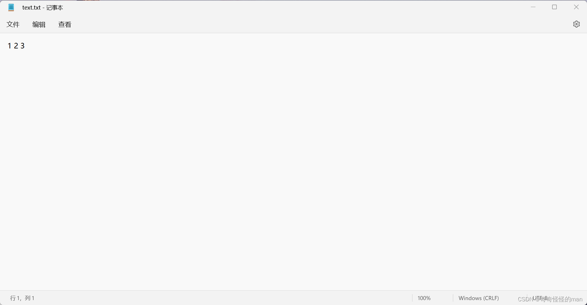
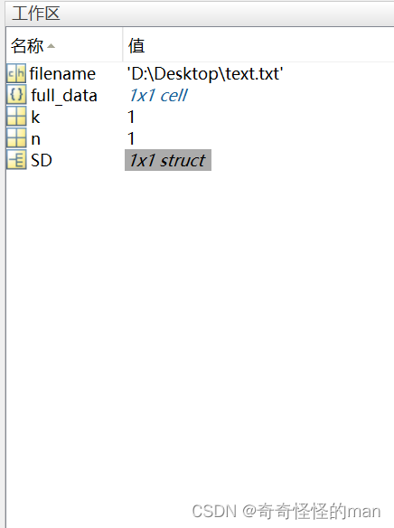

# MATLAB 数据输入与导入方式（手动输入、TXT 文件、Excel 导入）

> 原文发表于 2022-12-05，迁移至 GitHub 时进行了排版整理与代码格式化。

## 目录

- [一、手动输入（`input` 函数）](#一手动输入input-函数)
- [二、自动批量导入](#二自动批量导入)
  - [2.1 批量导入 TXT 文件到元胞数组](#21-批量导入-txt-文件到元胞数组)
  - [2.2 `dir` 函数详解](#22-dir-函数详解)
  - [2.3 `importdata` 函数详解](#23-importdata-函数详解)
  - [2.4 运行示例](#24-运行示例)
  - [2.5 批量导入 Excel 文件到元胞数组](#25-批量导入-excel-文件到元胞数组)

---

## 一、手动输入（`input` 函数）

`input` 函数用于在命令行窗口请求用户输入并返回结果。

### 基本语法

```matlab
x = input(prompt)          % 数值型或表达式输入
str = input(prompt, 's')   % 字符型输入（第二个参数 's' 固定不可更改）
```

### 1. 数值型输入演示

```matlab
P = zeros(5, 1);              % 建立 5×1 零矩阵用于存储
for i = 1:5                   % 循环输入 5 次
    prompt = '请输入数值: ';   % 命令行提示语
    P(i, 1) = input(prompt);  % 读取用户输入并存入矩阵
end
```

### 2. 字符型输入演示

```matlab
prompt = '请输入字符数值: ';
for i = 1:3                       % 循环输入 3 次
    str(i, :) = input(prompt, 's');
end
disp(str(1, :));                  % 查看第 1 行输入内容
```

> **注意**：使用二维字符数组 `str(i, :)` 接收字符型输入时，每次输入的字符串长度必须保持一致（若长度不固定，建议改用字符串数组 `string` 或元胞数组 `str{i}`）。

---

## 二、自动批量导入

### 2.1 批量导入 TXT 文件到元胞数组

当文件夹下有多个 `.txt` 数据文件且内部数据均为矩阵格式时，可以结合 `dir` 与 `importdata` 将每个 TXT 文件按序存入元胞数组（`cell`）中，后续按索引随时调出：

```matlab
SD = dir('D:\Desktop\*.txt');           % 匹配指定文件夹下所有 .txt 文件
n = length(SD);                         % 获取文件数量
full_data = cell(n, 1);                 % 预分配 n×1 元胞数组

for k = 1:n
    filename = ['D:\Desktop\', SD(k).name];   % 拼接第 k 个文件的完整路径
    full_data{k} = importdata(filename);      % 将每个文件的矩阵存入一个元胞单元
end
```

### 2.2 `dir` 函数详解

`dir` 用于列出文件夹内容：

```matlab
dir
dir name
listing = dir(name)   % 上述批量读取代码所使用的语法
```

- `dir`：列出当前工作文件夹中的所有文件和子文件夹。
- `dir name` / `listing = dir(name)`：列出与 `name` 匹配的文件和文件夹（支持绝对路径或相对路径）。
  - `name` 的文件名部分可包含 `*` 通配符（如 `*.txt`、`*.xlsx`）；
  - 路径部分可包含 `*` 和 `**`（递归子目录）通配符，且与 `**` 相邻的字符必须为文件分隔符。

### 2.3 `importdata` 函数详解

`importdata` 用于从磁盘文件或剪贴板加载数据：

```matlab
A = importdata(filename)                              % 上述代码所使用的基础语法
A = importdata('-pastespecial')
A = importdata(___, delimiterIn)
A = importdata(___, delimiterIn, headerlinesIn)
[A, delimiterOut, headerlinesOut] = importdata(___)
```

常用调用方式说明：
- `A = importdata(filename)`：自动识别文件格式并将数据加载到数组或结构体 `A` 中。
- `A = importdata('-pastespecial')`：直接从系统剪贴板而非文件加载数据。
- `A = importdata(___, delimiterIn)`：指定 `delimiterIn` 作为 ASCII 文本文件中的列分隔符。
- `A = importdata(___, delimiterIn, headerlinesIn)`：跳过前 `headerlinesIn` 行表头，从第 `headerlinesIn + 1` 行开始读取数值矩阵。
- `[A, delimiterOut, headerlinesOut] = importdata(___)`：额外返回自动检测到的列分隔符 `delimiterOut` 与标题行数 `headerlinesOut`。

### 2.4 运行示例

假设创建如下格式的 TXT 矩阵数据文件并放入 `D:\Desktop\` 路径下：



运行上述批量导入脚本后（此处示例目录中新建了 1 个文本文件），工作区中 `full_data` 的输出结果如下：


*`full_data` 输出结果*

以上方法非常适合数学建模竞赛或科研数据处理中**多文件、多矩阵**的批量读取场景。

### 2.5 批量导入 Excel 文件到元胞数组

批量读取 `.xlsx` 表格的方法与 TXT 完全一致，只需修改文件通配符后缀名：

```matlab
SD = dir('D:\Desktop\*.xlsx');          % 注意修改文件后缀名为 .xlsx（或 .xls）
n = length(SD);                         % 文件数量
full_data = cell(n, 1);                 % 预分配 n×1 元胞数组

for k = 1:n
    % filename = ['D:\Desktop\shuwei cup\question1\NESD\', SD(k).name];
    full_data{k, 1} = importdata(['D:\Desktop\', SD(k).name]);
end
```

> **注意事项**：使用上述两种导入方式时请注意 MATLAB 语法细节——避免路径或代码中混入多余空格，严格使用英文半角引号、括号与分号，否则容易触发语法报错。

> 如有问题或建议，欢迎在本仓库提交 [Issue](../issues) 交流。
